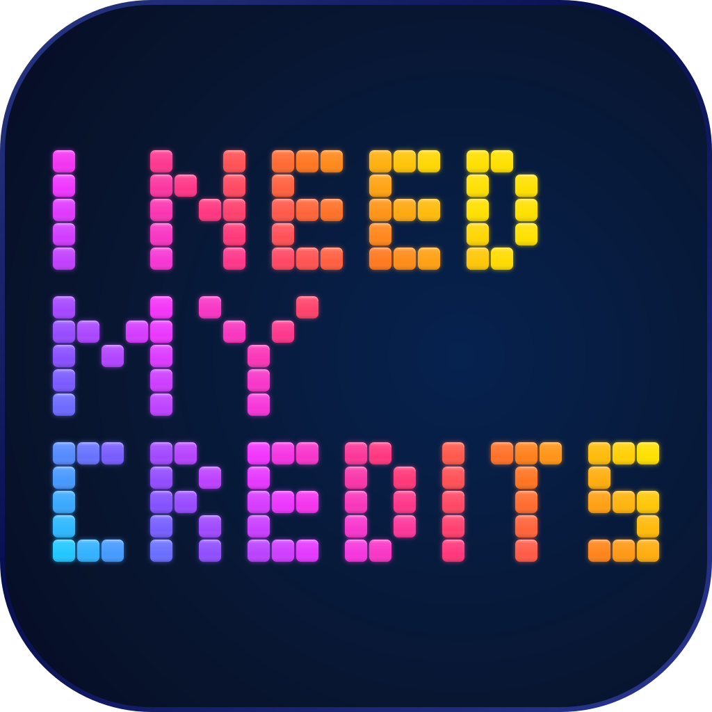
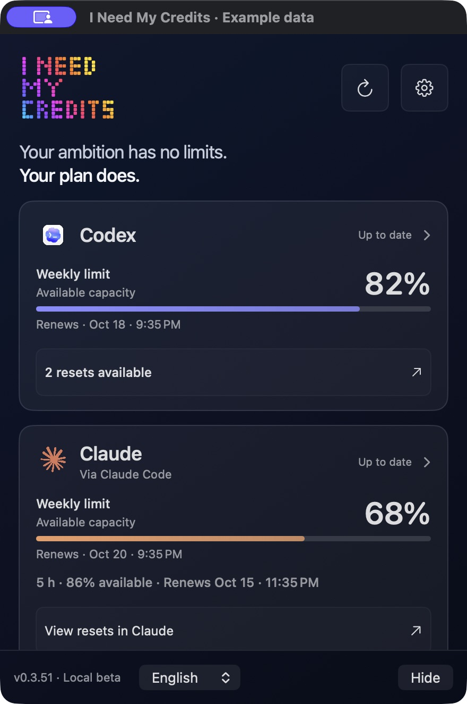
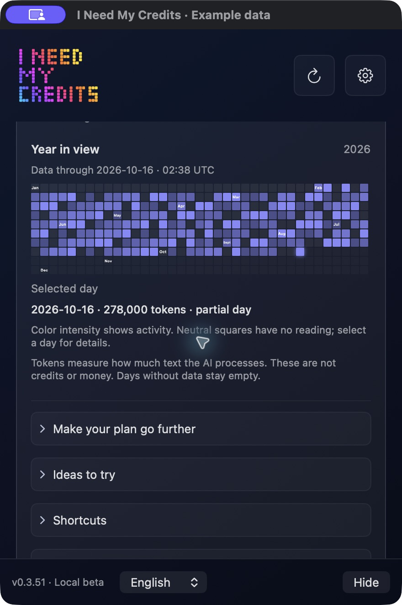
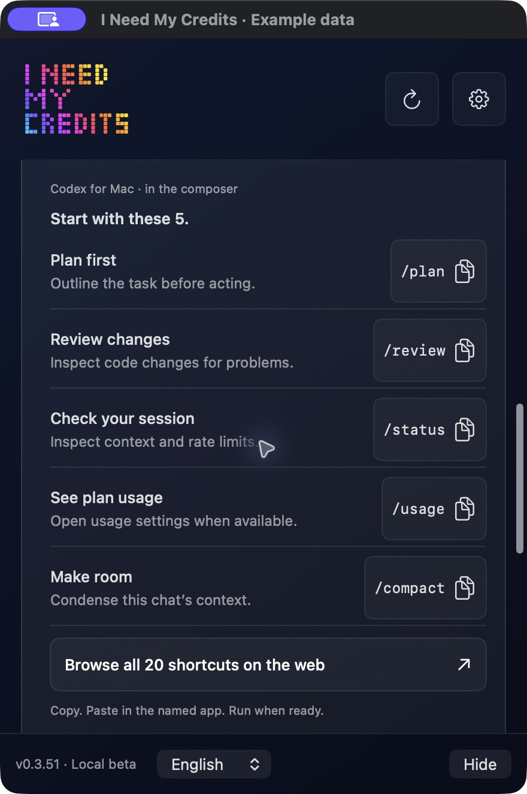

# I Need My Credits — Codex & Claude Code usage monitor for Mac

**Your ambition has no limits. Your plan does.**

The Halloween footer now preserves the original artwork proportions and the approved navy fade.

**0.3.66 is available on [the website](https://ineedmycredits.com/descargar) and [GitHub](https://github.com/srluismiguelj/i-need-my-credits/releases/tag/v0.3.66).** Choose Update in INMC, then Install Update and Install and Relaunch. From 0.3.65, discovery and signed native installation use GitHub directly, independently of website hosting. For older versions, see [update troubleshooting](docs/TROUBLESHOOTING.md#integrated-update-did-not-complete).

A free macOS menu bar **usage monitor for Codex and Claude Code**. Check remaining plan capacity and reset times before your next task, get useful usage alerts, and keep your ambition moving. No browser extension or INMC account.

[Download for Mac](https://github.com/srluismiguelj/i-need-my-credits/releases/download/v0.3.66/INeedMyCredits-0.3.66-universal.dmg) · [Latest release](https://github.com/srluismiguelj/i-need-my-credits/releases/latest) · [Setup guide](https://ineedmycredits.com/guia) · [Report an issue](https://github.com/srluismiguelj/i-need-my-credits/issues)

## Start with the tool you use

| Your tool | Check usage now | Keep the reading in your menu bar |
| --- | --- | --- |
| Codex | Run `/status` in an active Codex CLI session, or open its official usage dashboard. | [Codex usage monitor and setup](https://ineedmycredits.com/providers/codex) |
| Claude Code | Run `/usage`. Subscribers see plan usage bars; the Session cost estimate is separate. | [Claude Code usage monitor and setup](https://ineedmycredits.com/providers/claude) |

INMC is free. Provider subscriptions are separate. For the Claude Code connection, personal accounts need **Pro or Max**; Claude Free chat cannot authorize it. Codex needs a compatible account signed in on your Mac. [Read the usage limits guide](docs/USAGE-LIMITS.md) to compare remaining capacity, used percentages and tokens correctly.

## The app, at a glance

Know what’s left. Make your next move count.

  

<table>
  <tr>
    <td width="50%" valign="top"><strong>Your activity. In perspective.</strong> Explore Codex token activity across the year. Neutral days have no reading; tokens are separate from plan capacity.</td>
    <td width="50%" valign="top"><strong>A smarter next step.</strong> Keep five useful shortcuts ready to copy, with examples and links to official documentation.</td>
  </tr>
  <tr>
    <td valign="top"></td>
    <td valign="top"></td>
  </tr>
</table>

*Monitor: native macOS interface 0.3.60, including the compact header. Activity and shortcuts: native interface 0.3.51. Captured in isolated preview sessions; quotas, reset counts and activity are example data, not live account readings. No personal account information is shown. Click an image to view it at full size.*

## Monitor Codex and Claude Code usage

- Keeps available plan usage and reset times in your Mac menu bar.
- Reads Codex from the account already signed in on your Mac.
- Offers an optional Claude Code connection with explicit authorization. For personal accounts, this Claude Code connection requires Pro or Max; Claude Free chat cannot authorize it. Team or Enterprise access depends on the organization. Claude web and Desktop sign-in are separate.
- Shows recorded Codex daily token activity in a year grid. Select a reported day to compare it with your recent average and get a practical tip. Tokens are not your remaining plan allowance.
- Warns about low capacity, a sustained recent pace that could reach a limit, and low Codex capacity with no saved resets. Advice identifies the actual usage window and remains an estimate.
- Includes five quick shortcuts, useful task briefs and practical guides.
- Keeps usage metrics on your Mac. Optional product usage reports are off until you choose to share them.

You can explore [copyable ideas](https://ineedmycredits.com/ideas) and [smarter habits](https://ineedmycredits.com/smarter-usage) without connecting an account. Start with [a website launch-readiness workflow](https://ineedmycredits.com/ideas/website-launch): a free copyable prompt, worked example and checks for what actually works.

No browser extension, INMC account or credit card is required. Your subscriptions to AI providers are separate. Missing or expired readings stay unavailable; they never become 100% available.

[Set up usage alerts](https://ineedmycredits.com/smarter-usage/alerts) for capacity, recent pace and resets. New installations start with all categories selected after macOS permission; saved off choices stay off on update. Local chat-attention setup is separate and depends on supported events and provider trust. INMC does not analyze your questions or change reasoning automatically.

## Install

1. Download the signed, notarized universal DMG from the website or a release below.
2. Open **Install I Need My Credits** and follow the installer.
3. Sign in to Codex on your Mac. Connect Claude only if you use it, then approve its official sign-in flow when requested.

Requires macOS 13 or later. Universal binary for Apple silicon and Intel; testing on physical Intel hardware remains pending. Windows and Linux are not supported.

If you need help, use the app's **Suggest a feature** form or email **ineedmycredits.support@gmail.com**. Never send passwords, API keys, authorization links or private conversation histories.

## Frequently asked questions

### Does INMC give me AI credits?

No. INMC shows available capacity from your compatible provider plan. It does not sell, add or refill credits. API billing, token activity and subscription plan limits are different measurements.

### Do I need a browser extension or another account?

No browser extension or INMC account is required. Codex uses the account signed in on your Mac. Claude Code is optional and requires a compatible account plus its official authorization flow.

### Why does Claude say “Needs attention”?

A missing or expired authorization needs a fresh sign-in. Choose **Retry connection** or **Connect Claude** in INMC and complete the official Claude Code flow. Being signed in to Claude web or Desktop alone does not establish this connection. [Connection troubleshooting](docs/TROUBLESHOOTING.md#claude-code-needs-attention).

### Can I switch between two Codex accounts?

Yes. From 0.3.63, switch accounts in Codex and keep INMC open. It checks the current session and retries interrupted connections automatically. If needed, open the Codex connection details and choose **Reconnect to this account** for the detected account. Previous readings are hidden after a failed check. [Account-switch troubleshooting](docs/TROUBLESHOOTING.md#switching-codex-accounts).

### What do the percentages and year-grid squares mean?

The percentage is available plan capacity, not money. The annual grid shows recorded Codex token activity; neutral squares have no reading. A missing reading never means 100% remaining. [Understand the measurements](https://ineedmycredits.com/guia).

### How do app updates work?

From **0.3.65**, INMC checks the personal GitHub release at launch and periodically. The blue update button opens Sparkle's native download, verification, installation and relaunch flow. You choose when to install; connections and settings are kept. Both the update feed and archive are signed. No GitHub account is needed, and updates do not depend on the website.

For **0.3.61–0.3.64**, use the [one-time GitHub feed setup](docs/TROUBLESHOOTING.md#use-the-github-update-channel-on-03610364), then open Settings → **Check for updates**. For **0.3.60 or earlier**, use the signed DMG installer once to enable integrated updates. Initial installation still uses the DMG. Nothing installs silently. System alerts respect macOS permission and saved notification preferences. Official installers are signed, notarized and accompanied by SHA-256 checksums.

## Help and reliability

[Fix a connection or update](docs/TROUBLESHOOTING.md) · [Contact support](SUPPORT.md) · [Report a security issue privately](SECURITY.md)

Daily checks monitor the website, discovery files and agreement between GitHub releases and the app's update feed. A weekly check verifies every installer part and the complete SHA-256. These checks run on GitHub; they do not need your Mac to be on. [What is checked](docs/RELIABILITY.md).

## A small public experiment

INMC started as a hands-on experiment in building a brand, a native app, a website and an organic distribution path with AI. The scope is intentionally focused on Codex and Claude Code. New integrations are considered only when they can work reliably and simply.

This repository distributes official app releases and collects feedback. The application source code is not published here; this is not an open-source claim. All installers have a published SHA-256 checksum. Independent project by Luis Miguel Jiménez; not affiliated with or endorsed by OpenAI or Anthropic.

## Useful links

- [Codex setup and usage](https://ineedmycredits.com/providers/codex)
- [Claude Code setup and usage](https://ineedmycredits.com/providers/claude)
- [Five shortcuts and the full web collection](https://ineedmycredits.com/shortcuts)
- [Smarter AI habits](https://ineedmycredits.com/smarter-usage)
- [Privacy](https://ineedmycredits.com/privacidad)
- [Release notes](https://ineedmycredits.com/novedades)

[Español](https://ineedmycredits.com/es)
